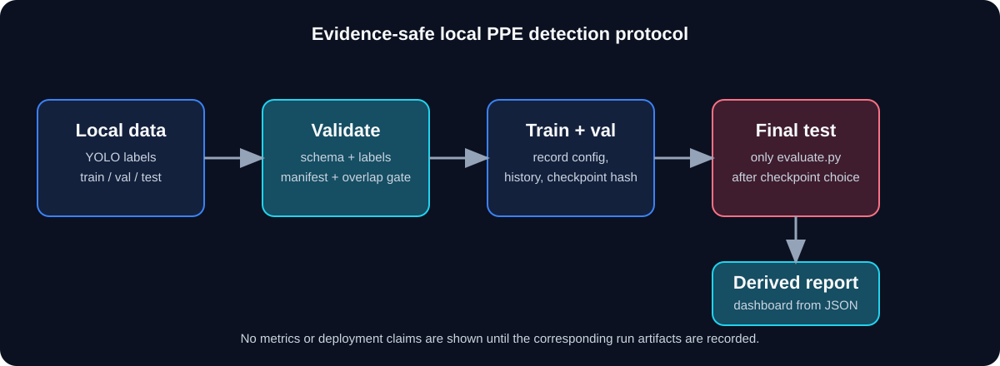

# Evidence-safe PPE detection baseline

[](https://github.com/AliNaderiii/dji-matrice-4td-yolo-pipeline/actions/workflows/ci.yml)
[](https://www.python.org/)
[](LICENSE)

A small, local-data reference pipeline for **three-class PPE object detection** with Ultralytics YOLO. Its purpose is to make a baseline experiment inspectable: validate data before a run, keep the test split held out, and link a reported score to the configuration, split manifest, selected weights, and recorded metrics.

**Protocol release:** `v2.0.0` ([VERSION](VERSION)).

> **Current evidence status:** no dataset, checkpoint, training run, held-out test metric, DJI integration, edge benchmark, ONNX export, cloud integration, or deployment result is included or claimed by this revision. Add claims only after recording the matching experiment artifacts.



## Why this revision exists

The earlier repository revision mixed incompatible class schemas and presented historical training/demo visuals alongside hardware, latency, and integration assertions whose supporting raw data, weights, and execution records are not versioned here. Those visuals are preserved in [`assets/legacy-v1/`](assets/legacy-v1/README.md) for provenance, but they are **not v2 evidence** and must not be reused as current benchmark or deployment results.

This revision deliberately narrows scope to an auditable training/evaluation baseline. It does not imply fitness for safety-critical monitoring. A detector alone cannot establish PPE compliance, alerting policy, human oversight, privacy practice, or operational safety.

## Contract and protocol

The sole authority is [`config.yaml`](config.yaml).

| Class ID | Class |
|---:|---|
| 0 | `person` |
| 1 | `hard_hat` |
| 2 | `no_hard_hat` |

Use one local YOLO-format dataset layout:

```text
data/
├── images/
│   ├── train/     # fitting split
│   ├── val/       # development validation / checkpoint selection
│   └── test/      # held out until final evaluation
└── labels/
    ├── train/
    ├── val/
    └── test/
```

- Images may use `.jpg`, `.jpeg`, `.png`, `.bmp`, `.tif`, `.tiff`, or `.webp`.
- A label file has one normalized YOLO row per object: `class_id x_center y_center width height`.
- An image without a `.txt` label is allowed and counted as a negative image.
- Orphan labels, duplicate stems, malformed labels, class IDs outside `0..2`, and sample-ID overlap across splits are rejected.
- `src.train` uses only train and validation. `src.evaluate` is the **only** command that passes `split="test"` to Ultralytics.

Read the full [evaluation protocol](docs/PROTOCOL.md) before creating results.

## Windows quick start

The commands below are PowerShell commands. Supply only data you are permitted to use; images, labels, weights, reports, and credentials are ignored by Git.

### 1. Create an environment

```powershell
git clone https://github.com/AliNaderiii/dji-matrice-4td-yolo-pipeline.git
cd dji-matrice-4td-yolo-pipeline
py -3.11 -m venv .venv
.\.venv\Scripts\Activate.ps1
python -m pip install --upgrade pip
```

Install a PyTorch/torchvision build appropriate for your CPU or GPU from [pytorch.org](https://pytorch.org/get-started/locally/), then install this repository's runtime packages:

```powershell
python -m pip install -r requirements.txt
```

For an automated repository-only preflight (compile, tests, and lint), run:

```powershell
.\tools\windows_preflight.ps1
```

Use `-InstallRuntime` after choosing your PyTorch build, and `-ValidateLocalData` only after creating the local `data/` layout.

### 2. Prepare and validate data

Create the layout above under `data/`, preserving the class order in `config.yaml`. Check it before any training:

```powershell
python -m src.validate_data --config config.yaml
```

The command prints a manifest with split sizes, class-box counts, negative-image counts, and sample IDs. Resolve every validation error rather than bypassing it.

### 3. Train without consuming test

```powershell
python -m src.train --config config.yaml
```

This records local provenance in `checkpoints/` and run outputs in `runs/`. The selected `best.pt` is chosen from validation behavior only. Do not inspect or tune against `data/images/test` during this step.

### 4. Evaluate the held-out test once the checkpoint is fixed

```powershell
python -m src.evaluate --config config.yaml
```

Evaluation verifies the recorded training metadata, class contract, current split counts, and checkpoint before writing `reports/test_metrics.json`. It is intentionally a separate action because test results are not a model-selection signal.

### 5. Build a dashboard from recorded artifacts (optional)

```powershell
python -m src.reporting
```

This creates `reports/experiment_dashboard.png` entirely from `checkpoints/run_metadata.json` and `reports/test_metrics.json`; it does not hard-code headline numbers. Keep the source JSON with any exported figure.

## Expected artifact chain

For every shareable experiment, retain these local artifacts and fill in the [experiment card template](docs/experiment-card-template.md):

1. `checkpoints/resolved_config.json` and `checkpoints/split_manifest.json`;
2. `checkpoints/run_metadata.json` with code revision, environment, parsed validation history, and checkpoint digest;
3. `checkpoints/checkpoint.sha256` and the exact selected weight file;
4. `reports/test_metrics.json` produced from the held-out test split;
5. any dashboard derived from those JSON files.

No score should be presented without this chain, dataset/license provenance, and a clear statement of the operating domain and limitations.

## Quality checks

Core validation and tests do not need a dataset, PyTorch, or Ultralytics:

```powershell
python -m pip install -r requirements-dev.txt
python -m compileall -q src tests
python -m pytest
python -m ruff check src tests
```

On Unix-like systems, equivalent shortcuts are available through `make validate`, `make train`, `make evaluate`, `make report`, `make test`, and `make lint`.

## Scope boundaries

This repository currently provides no implementation or verified evidence for:

- DJI Matrice 4TD, drone payloads, NPU/Jetson/NVR compatibility, or real-time latency/FPS;
- ONNX/TensorRT/OpenVINO export or performance;
- MQTT, AWS IoT, Azure IoT, cloud dashboards, or credentials;
- real-world PPE compliance, surveillance, alerts, or safety outcomes.

Those require their own source code, environment record, hardware evidence, and evaluation protocol before they can be described as supported.

## License

Released under the [MIT License](LICENSE). Dataset licenses and permissions remain the responsibility of the dataset provider and user.
